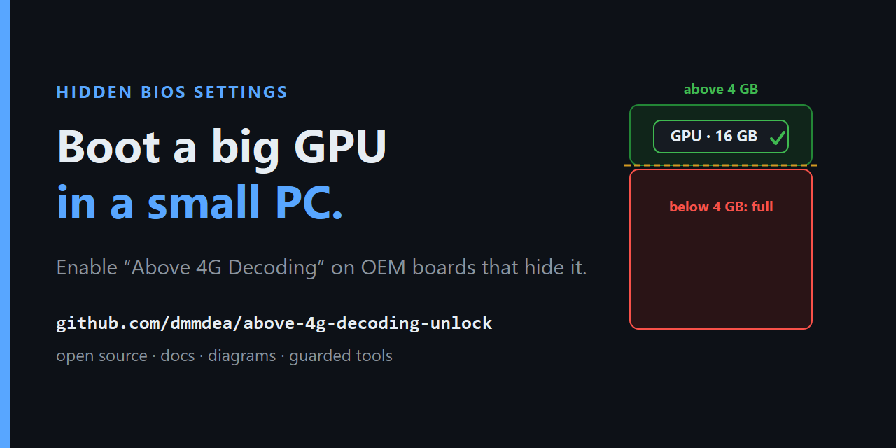
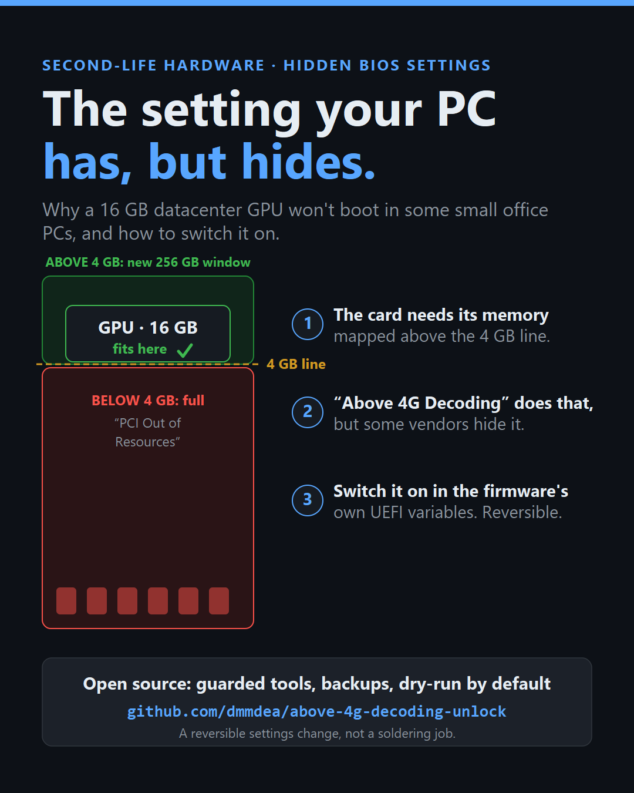
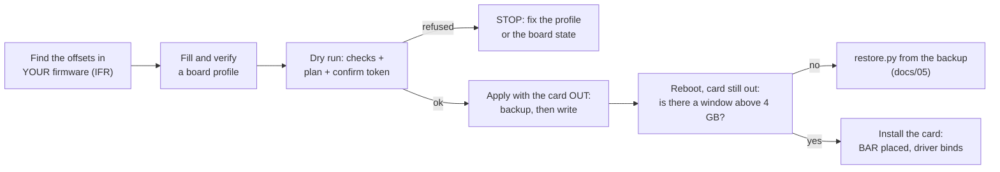

<!--
Keywords: enable hidden Above 4G Decoding, Above 4GB MMIO BIOS assignment, PCI Out of Resources fix,
datacenter GPU in a small OEM PC, NVIDIA A2 T4 L4 large BAR will not boot, hidden UEFI setup variable,
efivarfs, Lenovo ThinkCentre M720q Above 4G, Lenovo Error 0162 Setup checksum, LastCheckSum,
reuse a retired office PC, reduce e-waste.
-->

# Enable a hidden "Above 4G Decoding" so a large-BAR GPU boots in an OEM PC



**Some OEM office PCs stop at POST with "PCI Out of Resources" when you install a GPU with a large memory
window, such as a 16 GB datacenter card. The fix is a BIOS setting, Above 4G Decoding, that the firmware
contains but the vendor hides from the menu. This repo documents how to turn it on through the
firmware's own UEFI setup variables, and ships guarded tools that back up first, refuse unsafe writes,
and handle a vendor checksum that would otherwise undo the change.**

> [!WARNING]
> This changes your own, out-of-warranty BIOS settings. A wrong write can make the board reload defaults
> or stop booting. Recovery is not guaranteed: `restore.py` needs a board that still boots to an OS, on
> some boards a CMOS clear does not reset these variables, and the reference board had no out-of-band
> recovery. Read [docs/05-safety-and-recovery.md](docs/05-safety-and-recovery.md) before you write anything.



## In short

| | |
|---|---|
| **Problem** | A 16 GB GPU memory window (BAR) cannot fit in the 32-bit space below 4 GB. Unless the firmware opens a window above 4 GB, POST fails with "PCI Out of Resources". |
| **Why there is no checkbox** | Some OEM firmware ships Above 4G Decoding (and a companion option, "Above 4GB MMIO BIOS assignment") but hides both from the menu. Hidden settings still live in UEFI variables. |
| **Method** | Find the setting's offset in **your own** firmware's IFR, back up the variables, change one byte, and if the vendor guards the store with a checksum, write a matching checksum. From Linux through efivarfs where the variables are runtime-visible. |
| **Guardrails** | Dry run by default; a per-board profile you must verify; BIOS-version match; exact variable lengths and old values; authenticated variables refused; guard flags must be clear; the checksum relationship measured live and bounded; backup with a manifest before any write; one whole-blob write per variable; scripted restore. |
| **Proven on** | Lenovo ThinkCentre M720q Tiny, BIOS M1UKT72A, with a 16 GB NVIDIA A2. A 256 GB window above 4 GB appeared, the card's BAR landed in it, and the driver bound. Other boards are candidates, not proven ([docs/02](docs/02-does-my-hardware-qualify.md)). |

## The flow



## Quick start (Linux, as root, from `tools/`)

```sh
python3 selftest.py                                   # must end with SELF-TEST PASSED
cp profile.example.json my-board.json                 # fill from YOUR firmware, then set verified_by_user
sudo python3 above4g_unlock.py unlock --profile my-board.json --only setup          # dry run
sudo python3 above4g_unlock.py unlock --profile my-board.json --only setup \
     --apply --i-understand-the-risk --backup-dir /mnt/usb/backups --confirm <token from the dry run>
# --backup-dir must survive a reboot: a USB stick or disk partition, never a live system's own RAM-backed root
# reboot with the card out, then:
sudo python3 above4g_unlock.py verify --profile my-board.json --only setup --report /mnt/usb/backups/efivar-backup-<timestamp>
```

`profile.example.json` holds the reference board's values and says so in its first line. Offsets move
between BIOS builds; never copy them to another board or BIOS version. How to read your own:
[docs/04-procedure.md](docs/04-procedure.md).

## How the tools were tested

- `selftest.py`: 130 tests (count when last run, 2026-10-13) against a synthetic efivars directory, including every refusal path.
- An independent replay of the reference board's state before the successful write (Setup sum 0xDC23,
  stored checksum 0xDC24, PCI_COMMON byte 0 already set by the earlier failed attempt): the tool changed
  exactly Setup byte 0xA49, wrote checksum 0xDC25 and set PCI_COMMON byte 3 with byte 0 untouched,
  which are the bytes the real write produced. `restore.py` then put all three variables back
  byte for byte.
- In the same replay the tool refused, and changed nothing, for: an unverified profile, a different BIOS
  version, a checksum delta out of bounds or negative, a wrong variable length, a field holding an
  unexpected value, an authenticated attribute, a set guard flag, a missing risk flag, backup directory or
  confirm token, and a profile asking for an 8-byte write.
- Not yet run against a real efivarfs mount. The write mechanics (one write of attributes plus data,
  immutable flag cleared first) follow the script that worked on the reference build.

## Who did what on the reference build

An AI coding agent did the firmware analysis (on its own machine) and every live variable read and
write (over SSH). The owner's part was physical: installing and removing the card. The first attempt
wrote the wrong byte and changed nothing visible; testing with the card out made that harmless. The
story, including what is still unproven, is in [docs/06-reference-build.md](docs/06-reference-build.md).

## Documentation

| Doc | What it covers |
|---|---|
| [01 Background](docs/01-background.md) | Why reusing retired PCs and GPUs matters now, with the numbers |
| [02 Does my hardware qualify?](docs/02-does-my-hardware-qualify.md) | Checks, decision tree, known platforms, guard and lock detection |
| [03 How it works](docs/03-how-it-works.md) | BARs, the 4 GB line, UEFI variables, the two gates, the checksum guard |
| [04 Procedure](docs/04-procedure.md) | The runbook, phase by phase |
| [05 Safety and recovery](docs/05-safety-and-recovery.md) | Failure modes and the recovery ladder |
| [06 Reference build](docs/06-reference-build.md) | ThinkCentre M720q + A2, end to end |
| [07 FAQ](docs/07-faq.md) · [08 Glossary](docs/08-glossary.md) | Short answers and terms |
| [09 Tooling and prior art](docs/09-tooling-and-prior-art.md) | ReBarUEFI, setup_var.efi, UEFITool, IFRExtractor and what this repo adds |
| [tools/](tools/) | The guarded tools and the example profile |

## Credits

This builds on the resizable-BAR and hidden-setting community: xCuri0's ReBarUEFI, datasone's
setup_var.efi, LongSoft's UEFITool and IFRExtractor-RS, and the forum threads where people first worked
out which variable byte does what on which board. What this repo adds is the guarded, measured workflow:
board fingerprint, backup first, refusal of wrong-size or protected writes, a live checksum model, and
verification by physical outcome.

## License and trademarks

Code: MIT, no warranty. Docs and images: CC BY 4.0 (see [LICENSE](LICENSE)). Editing your own firmware
settings is your decision and your risk. Lenovo, ThinkCentre, NVIDIA, AMI and Intel are trademarks of
their owners, used here only to describe hardware; this project is not affiliated with or endorsed by
any of them.
