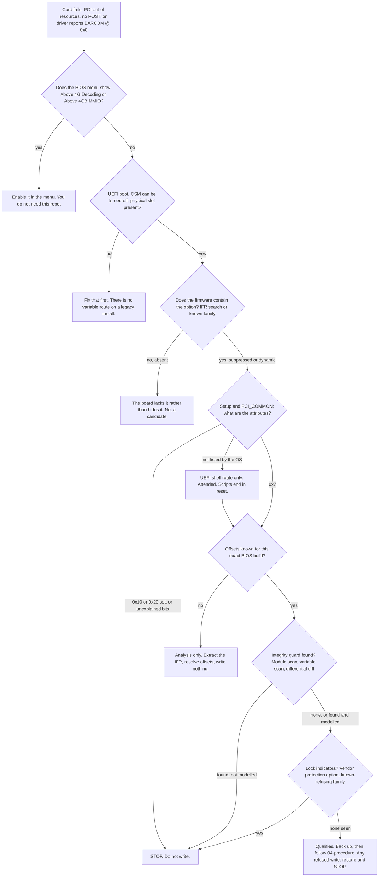

# Does my hardware qualify?

A board qualifies for this method when both of these are true:

1. The firmware contains an Above 4G Decoding or Above 4GB MMIO setting, and the vendor hides it from the menu. A firmware that never had the setting is a different problem, and nothing in this repo fixes it.
2. You can reach the variables that hold the setting, either from the running OS (Linux `efivarfs`) or from a one-time UEFI shell session, and nothing in the firmware refuses or reverts the write.

This page is how you check both before you change a byte. Every check here is read-only, with one exception covered in Step 7: a variable lock can only be proven by a write that gets refused. The method itself edits settings variables on your own out-of-warranty machine. It does not touch firmware code, does not flash the SPI chip, and does not try to get around any signature check. Where a board's own protections say no, you stop. The steps that carry risk are marked, and the recovery side lives in [05-safety-and-recovery.md](05-safety-and-recovery.md).

On the reference build (a Lenovo ThinkCentre M720q Tiny with a 16 GB NVIDIA A2) an AI agent did the work. The image analysis ran on the agent's own computer, and the live variable reads and writes ran over SSH. The owner's only hands-on steps were physical: installing the card and removing it again.

## How claims are labelled

Skeptical reading is the right way to use this page, so each non-obvious claim carries one of these tags.

| Tag | Meaning |
|---|---|
| **Verified** | Measured on the reference build. One unit, one BIOS family. |
| **Primary** | Stated by a specification, vendor document or source file, linked. |
| **Reported** | A third-party forum or issue report, linked. Not reproduced here. |
| **Inference** | Reasoning from the above. Not tested. |
| **Unconfirmed** | Taken from notes or a snippet, with no recorded outcome. |
| **No evidence** | The research looked and found nothing either way. |

The web sources were read through automated summaries of the pages, not line by line. Paraphrase is used instead of quotation for that reason. Re-open the linked page before you rely on a detail.

## The decision tree



Each box is a step below. The order matters: cheap, reversible checks come first, and nothing in the tree writes until the last box.

## Step 1: confirm it is a BAR-placement failure

The setting only helps when the card's 64-bit memory windows (BARs) do not fit below the 4 GB line. The usual signatures:

| Where | What you see | Tag |
|---|---|---|
| POST | A "PCI Out of Resources" or "Insufficient PCI Resources Detected" screen, sometimes a boot loop | **Verified** (reference build) |
| POST | No video and a beep pattern (3 long, 3 short on an HP EliteDesk 800 G5 SFF with a Tesla T4), setup unreachable | **Reported**: [thread](https://winraid.level1techs.com/t/96245) |
| Linux, card present | The driver logs `This PCI I/O region assigned to your NVIDIA device is invalid` and `BAR0 is 0M @ 0x0`, then the probe fails | **Reported**: [NVIDIA forum](https://forums.developer.nvidia.com/t/tesla-t4-pci-i-o-region-invalid/120643) |
| Linux, card present | `lspci` shows the card absent from the PCIe bus (an M90q with an eGPU dock) | **Reported**: [thread](https://winraid.level1techs.com/t/117014) |

A card whose BARs fit below 4 GB does not need any of this. See [The GPU side](#the-gpu-side) for how to read your card's BAR size.

Enabling the setting is also not guaranteed to be enough. A Dell Precision T7820 (BIOS 2.40.0) exposes Above 4G and has it enabled, yet a Tesla P40 only reached POST after BIOS virtualization options were switched off, and the NVIDIA driver still reported BAR1 to BAR5 as `0M @ 0x0` ([**Reported**](https://winraid.level1techs.com/t/102347)). This repo addresses one cause of BAR failure, not all of them.

## Step 2: check the menu, then the prerequisites

Look in the menu first. The setting goes by several names:

- Above 4G Decoding
- Above 4GB MMIO BIOS Assignment (some vendors list it under System Agent configuration; **Reported**, weak source: one vendor reply seen in a search summary)
- Memory Mapped I/O above 4 GB (Dell servers and racks, under Integrated Devices)
- PCI 64-Bit Resource Allocation, with MM Config Base (Lenovo ThinkSystem servers)

If any of them is visible, enable it there and stop reading. Dell and Lenovo server documentation describes these options; both were seen only as search-result summaries, so treat the names as **Reported**.

If none is visible, check the prerequisites before going further.

| Prerequisite | Why | Tag |
|---|---|---|
| UEFI boot. Linux: `test -d /sys/firmware/efi && echo UEFI` | Firmware variables are not reachable from a legacy-BIOS install. The Windows `SetFirmwareEnvironmentVariableEx` call fails on one | **Primary**: [Microsoft docs](https://learn.microsoft.com/en-us/windows/win32/api/winbase/nf-winbase-setfirmwareenvironmentvariableexa) |
| CSM off before Above 4G is on | Turning 4G decoding on with CSM enabled can give a black screen or lock you out of setup. A Windows install in MBR mode needs converting to GPT before CSM goes off, or it may not boot | **Primary**: [ReBarUEFI wiki](https://github.com/xCuri0/ReBarUEFI/wiki/Enabling-hidden-4G-decoding) |
| Secure Boot off, shell route only | Shell tools such as `setup_var.efi` are unsigned. You can turn Secure Boot back on afterwards. The `efivarfs` route runs no unsigned UEFI code | **Primary** (wiki above) for the shell tools; the `efivarfs` half is **Inference** |
| A physical way to attach the card | A PCIe slot or riser, an M.2-to-PCIe or OCuLink adapter, or a Thunderbolt/USB4 dock. An HP EliteDesk 800 G4 Mini has no standard PCIe slot | **Reported** (HP community thread, seen in search results only) |

On the reference build the first boot after the change is done with the card out, so a wrong guess costs you a reboot and not a card swap. That belongs to the procedure in [04-procedure.md](04-procedure.md), but it affects what "qualifies" means: you need to be able to boot without the card.

## Step 3: does the firmware contain the option?

Two kinds of evidence answer different questions, and you want both.

| | Tells you | Does not tell you |
|---|---|---|
| **Live variables** (Step 4) | Which stores exist, their sizes, their attributes, which guard variables sit next to them | Whether the option exists, or where |
| **Firmware image** (this step) | Whether the question exists, which store and offset it uses, whether it is suppressed, which modules might guard it | Attributes, or whether a lock will refuse your write |

Get the vendor's own update package for the exact BIOS build you run, extract the `Setup` module and turn its IFR into text. The commands are in [04-procedure.md, section 0.5](04-procedure.md#05-derive-your-own-offsets). You never write the image back in this method, and you do not commit it to this repo.

For the qualification decision, the listing has to show four things:

1. **The question exists and is hidden, not absent.** It sits behind a `SuppressIf`, a `GrayOutIf` or a page the vendor never shows. On the reference build it is suppressed when the Aperture Size question equals `0xF`.
2. **You read the offset from that question's own `VarOffset`, never by searching for a number.** On the reference build a text search for "Above 4GB MMIO" matched the last line of the help text of the preceding question, Aperture Size (offset `0x993`, a size selector), which is not the gate. The real gate is `Setup` offset `0xA49`, QuestionId `0x54` (**Verified**). The full story is in [03, section 2.2](03-how-it-works.md#22-a-hidden-menu-option-is-still-a-variable).
3. **You know the field width.** The low two bits of a numeric question's `Flags` encode its size: 0 is one byte, 1 is two, 2 is four, 3 is eight ([EDK2 header](https://github.com/tianocore/edk2/blob/master/MdePkg/Include/Uefi/UefiInternalFormRepresentation.h)). A flags value of `0x10` therefore reads as a one-byte field (**Inference** from the constants). Never write more bytes than the field is wide. A forum command for the M720q passes `-s 0x08`, which is a byte count in the 0.2.x syntax of `setup_var.efi` ([**Reported**](https://winraid.level1techs.com/t/104420)); whether the poster meant bits or bytes is **Inference**. See [09](09-tooling-and-prior-art.md#setup_varefi-datasone).
4. **The offsets belong to your build.** On the reference build the running BIOS (M1UKT72A) and the dissected image (M1UKT77A) agreed on 6 of 6 offsets checked. That says nothing about other families, such as the M90q's M2W line (**Verified** for the pair, **Inference** for the rest).

Even a perfect IFR only shows that a question exists. [Kostr's lesson](https://github.com/Kostr/UEFI-Lessons/tree/master/Lessons_uncategorized/Lesson_Hidden_BIOS_settings) warns that driver code may not read the option at all, so a found setting can be inert.

### Dynamic questions

On AMI Aptio V firmware, "Above 4G Decoding" is often a dynamic question that the PciBus driver appears to add at runtime (**Inference**), so the static IFR shows only its neighbours. On the M720q the `PCI_COMMON` store shows BME DMA Mitigation and Hot-Plug and nothing else. Three ways to find the byte, cheapest first (steps in [04, section 0.5](04-procedure.md#05-derive-your-own-offsets), step 6):

1. Compare against other boards using the same store. The reports in the matrix below for the Dell Precision T3620, the Lenovo P310 and the ASUS X299 all touched `PCI_COMMON` byte 3 for this purpose, with different results. Treat it as a hypothesis (**Reported**).
2. Dump the live HII database from a UEFI shell with `ShowHIIext.efi save` and run IFRExtractor on each package list (Kostr's lesson, **Primary**).
3. Disassemble PciBus. On the reference build an earlier disassembly showed a default initialiser that writes byte 3 as 1 when the store is missing, while Lenovo's stored default has it at 0, and a Lenovo SMM module that toggles byte 3 (**Reported**: earlier disassembly, not re-run; only the SMM module's presence in the image was confirmed).

## Step 4: read the stores and their attributes

On Linux, `efivarfs` shows each variable as a file: four bytes of attributes (little-endian) followed by the data. A variable with 2 bytes of data is 6 bytes on disk ([kernel docs](https://docs.kernel.org/filesystems/efivarfs.html)). This script only reads.

```sh
cd /sys/firmware/efi/efivars
for f in $(ls | grep -iE '^(Setup|PCI_COMMON|LastCheckSum)-'); do
  size=$(( $(stat -c %s "$f") - 4 ))
  attrs=$(od -An -tx4 -N4 "$f" | tr -d ' ')
  printf '%-58s data=%s bytes  attrs=0x%s\n' "$f" "$size" "$attrs"
done
```

Expected on the reference build, built from its measured sizes and attributes rather than pasted from a terminal:

```
LastCheckSum-e102c8aa-0f10-4a0e-90a7-a6f816089bb7          data=2 bytes  attrs=0x00000007
PCI_COMMON-aca9f304-21e2-4852-9875-7ff4881d67a5            data=7 bytes  attrs=0x00000007
Setup-ec87d643-eba4-4bb5-a1e5-3f3e36b20da9                 data=5000 bytes  attrs=0x00000007
```

The `Setup` store is 0x1388 bytes there. The GUID and the data length are your fingerprint: if they match a row in the matrix below, you have a candidate offset to check against an IFR of your own BIOS build. The GUID `EC87D643-EBA4-4BB5-A1E5-3F3E36B20DA9` is shared by several AMI-based boards (Lenovo M720q, ASUS X299). It works as an identity check and says nothing about offsets.

Two cautions on names. Some firmware has two variables called `Setup` with different GUIDs: an early Dell XPS 8930 BIOS has a 12-byte dummy beside the real one ([**Primary**](https://github.com/datasone/grub-mod-setup_var)). Resolve by GUID, not by name. And `setup_var.efi` 0.3.x addresses variables by name and needs a variable id to pick between duplicates.

### What the attributes mean

| Attributes | Meaning | Route | Tag |
|---|---|---|---|
| `0x7` (non-volatile, boot-service, runtime) | Visible to the OS | OS route is possible. Reachable is not the same as writable: a lock can still refuse (Step 7) | **Verified** (reference build, both stores) |
| `0x3` (no runtime bit) | Not exposed after boot, so it does not appear in `efivarfs` | UEFI shell route only, with Secure Boot off and someone at the keyboard. Windows returns error 203 for such a store on an ASUS X299-E Gaming II | **Reported** by the project author, one board. That a store without the runtime bit is invisible to the OS follows from the definition ([Microsoft](https://learn.microsoft.com/en-us/windows/win32/api/winbase/nf-winbase-setfirmwareenvironmentvariableexa), **Primary**); the exact error Linux shows is unconfirmed |
| `0x10` or `0x20` set (authenticated write, time-based authenticated write) | Authenticated variable. `setup_var`-style tools set the value blindly and the firmware answers with a security violation | **Stop** | **Reported** ([thread](https://winraid.level1techs.com/t/103324)), bit values **Primary** |
| Anything you cannot explain | | **Stop** | |

The bit values are non-volatile `0x1`, boot-service `0x2`, runtime `0x4`, hardware-error-record `0x8`, authenticated write `0x10`, time-based authenticated write `0x20`, append `0x40`.

If the store is not listed at all, that does not mean the firmware lacks it. It means you have to use the shell route. That route is attended, and every startup script must end with an unconditional `reset`: a one-shot shell script without one left a headless test machine dark for over ten minutes (**Reported** by the project author). `setup_var.efi` also, going by its README, has no notion of vendor checksums, so do not take the shell route on a board where Step 6 finds a guard you cannot model (**Inference**).

Two rules about the variables themselves. First, an existing variable's attributes cannot be changed by overwriting it; the documented way is delete and recreate ([Microsoft](https://learn.microsoft.com/en-us/windows/win32/api/winbase/nf-winbase-setfirmwareenvironmentvariableexa)). Never do that to a setup variable, because deleting non-standard variables can leave a board unable to POST ([kernel docs](https://docs.kernel.org/filesystems/efivarfs.html)). Second, `efivarfs` marks non-standard variables immutable so that an accident cannot write them. `chattr -i` removes that flag. It is a safety catch in the kernel, not a firmware lock.

## Step 5: find the offsets with the two-gate model

Two different stores can hold a setting that looks like "Above 4G". Which one matters depends on the board, and the evidence does not always say.

| Gate | Store | What it is | On the reference build | Tag |
|---|---|---|---|---|
| A | `Setup` (`EC87D643-…`) | The question "Above 4GB MMIO BIOS assignment". Static IFR entry, one byte, default Disabled, suppressed while Aperture Size equals `0xF` | Offset `0xA49` on BIOS M1UKT72A (running) and M1UKT77A (dissected) | **Verified** |
| B | `PCI_COMMON` (`ACA9F304-21E2-4852-9875-7FF4881D67A5`) | "Above 4G Decoding", a dynamic question added by PciBus. Not in the static IFR | Byte 3 is the candidate | **Inference** from other boards |

What the reference build shows, stated plainly:

- The second attempt changed `Setup[0xA49]` and `PCI_COMMON[3]` in the same boot cycle. It worked.
- The kernel log showed a new 64-bit root window, `[mem 0x4000000000-0x7fffffffff window]` (256 GB), before any card was installed. That points at gate A. An earlier disassembly of this build's PciBus reads only bytes 0 and 5 of `PCI_COMMON`, which fits (**Reported**: earlier disassembly, not re-run).
- Whether byte 3 was necessary is **unproven**. Nobody ran the isolating test: revert byte 3 alone, reboot without the card, and read the window again.
- The first attempt misread the wrong question in `Setup` (a misreading of the IFR, see the traps in Step 3; nothing was written there) and wrote `PCI_COMMON` byte 0, on a guess that AMI stores put the first field at byte 0. That guess was wrong, and byte 0 stayed set afterwards. Its effect is unknown, and it means the second attempt did not start from a pristine `PCI_COMMON`. **A public recipe must not write `PCI_COMMON` byte 0.**

What other sources say:

- The ReBarUEFI wiki states that the `PCI_COMMON` store usually does not enable 4G decoding even though it contains the setting, and that some platforms also need Above 4GB MMIO assignment ([**Primary**](https://github.com/xCuri0/ReBarUEFI/wiki/Enabling-hidden-4G-decoding)). That is consistent with gate A doing the work on the reference build.
- On the Dell Precision T3620 and the ASUS X299, edits to `PCI_COMMON` byte 3 were reported to matter or to be already set. On the Lenovo ThinkStation P310 the byte reads 1 and GPU-Z still reports no 4G decoding ([**Reported**](https://winraid.level1techs.com/t/94916)).

So: treat both stores as candidates, and verify by physical outcome, never by reading the value back. A value that reads 1 proves a write happened and nothing else. The outcome checks are standard Linux tools, not individually sourced:

```sh
dmesg | grep -iE 'root bus resource|can.t assign|no space'
cat /proc/iomem                               # as root; look for a window and card BARs above 0x100000000
lspci -vv -s <bus:dev.fn> | grep -i region    # 64-bit, prefetchable, address above 4 GB
nvidia-smi -q -d MEMORY                       # BAR1 total, once the driver binds
```

## Step 6: detect an integrity guard before writing

Some vendors store a checksum of the setup store and compare it on every boot. If your edit leaves the checksum stale, the board throws a setup error and reloads defaults, which silently undoes the change. You want to know that before the first write.

### The Lenovo guard (PEI half verified, DXE half reported)

- **Verified** (by decoding the PEI module's bytes): a module named `SetupCheckSumPei` (GUID `76D1059D-2E22-40EF-A31F-C49DBBC0DBCE`) reads `Setup`, computes a 16-bit sum of its bytes (no carry fold, no complement) and compares it, exactly, with a variable named `LastCheckSum`. That variable lives under the Lenovo GUID `E102C8AA-0F10-4A0E-90A7-A6F816089BB7`, **not** under the Setup GUID. It holds 2 data bytes, little-endian, attributes `0x7`. Three flags sit alongside: `SetupDataChecksumError`, `RestoreSetupDataFlag` and `BIOSSetupDataChangedFlag`. All read 0 on a healthy box. A fourth variable, `LastSetupdataSum`, also exists; its role is unknown and the reference procedure never touched it.
- **Reported** (earlier image analysis; the error was never provoked on the reference build): on a mismatch the firmware shows `Error 0162` (Setup data integrity check failure) and reloads defaults. Lenovo's [POST-error page](https://pubs.lenovo.com/st50/POST_ERROR_0162) documents the message for ThinkSystem ST50 servers, so it documents the message, not the ThinkCentre mechanism.
- The decoded module skips the check only for boot mode `0x20`, which the UEFI PI specification assigns to recovery mode (constant not re-checked against the spec text). No other skip condition was found. Nothing here depends on it, and it is not a way around the check.
- The stored value minus the OS-visible 16-bit sum was +1 on one date and 0 on a later date, on clean boots. The cause is unknown, so always measure it live, on your own board, on the boot you are about to act on. This repo's tools do that and accept a delta of 0 or 1 by default. The original one-off script on the reference build accepted 0 to 2. Both bounds are heuristics, not derived from anything, and the post-reboot flags are the real test.

The read-only measurement script, the write order and the failure handling are in [03, section 3](03-how-it-works.md#3-the-vendor-integrity-guard) and in [04, sections 2.3 and 2.4](04-procedure.md). Three separate variable writes are not atomic, and you never delete or recreate `LastCheckSum`; see the note on deleting variables in Step 4.

### Looking for a guard on other boards

These detection methods are **proposed, not proven**. The firmware-image scan is how the Lenovo guard was found; the others were not exercised on the reference build.

1. **Module scan.** In the UEFIExtract report, list PEI and early DXE modules whose names contain `CheckSum`, `Crc`, `Hash`, `Integrity`, `Validate` or `SetupData`. You can also scan the raw image for UTF-16 strings: `strings -e l image.rom | grep -iE 'checksum|crc|hash|integrity|setupdata'`. PEI volumes are stored uncompressed and DXE is compressed, so error text such as "Error 0162" will not show up in the raw image.
2. **Variable scan.** `ls /sys/firmware/efi/efivars | grep -iE 'sum|crc|hash|integrity|error|restore|changed'`. Expect noise. You are looking for names that sit beside the setup store.
3. **Differential observation.** Snapshot every variable, change one visible option in the normal Setup menu, save and exit, snapshot again, and diff. Any variable other than `Setup` that changed is a guard or bookkeeping variable. Then try candidate checksums (sum8, sum16, CRC16, CRC32) over `Setup` before and after to see which one matches the changed value.
4. **Pre-flight.** Read every guard flag and require them all to be 0.
5. **If you find a guard you cannot model, stop.** An unknown algorithm, an authenticated variable or an SMM-written value means you do not have enough to write safely.

What is known for other vendors:

| Vendor | Finding | Tag |
|---|---|---|
| ASUS (X299-E Gaming II) | No Setup checksum guard seen. Bytes written in one boot survived a full power cycle | **Reported** by the project author, one board |
| Dell | No public documentation of a Setup checksum found. A T3620 edit persisted after a CMOS battery pull, which suggests the store is not in CMOS | **No evidence** for a guard; the CMOS point is **Inference** |
| HP | No documentation of a checksum. Reports are of refused writes (Step 7) | **No evidence** |
| Lenovo ThinkStation P330 tower | A tool accepts the enable flag, then the setting is gone after restart ([thread](https://winraid.level1techs.com/t/104196)) | **Reported**. That a checksum guard causes it is **Inference** |
| Any AMI NVRAM-level CRC | No public source found | **No evidence**. Do not claim either way |

## Step 7: detect a variable lock before writing

A lock cannot be fully detected without attempting a write. Firmware can refuse a write after the OS has booted, and nothing in `efivarfs` lists the policy. What you can check beforehand:

1. **Attribute bits.** `0x10` or `0x20` means authenticated. Stop (Step 4).
2. **A vendor menu option.** Some ASUS boards have a "UEFI Variables Runtime protection" option. Users of an ASUS ProArt Z790 and a TUF 15 reported a "SetVariable called security violation" on writes, and a reply on that thread says the variable carried authenticated-access attributes ([**Reported**](https://winraid.level1techs.com/t/103324)). The same thread reports RU.efi's edits being reverted under that protection.
3. **Known-refusing families.** An HP EliteDesk 800 G5 SFF answered a `setup_var.efi` write with `ACCESS_DENIED`; a modified BIOS image failed signature verification ([**Reported**](https://winraid.level1techs.com/t/96245)). The cause is unknown: VariablePolicy, Sure Start, an SMM write path or authenticated attributes would all fit. An HP support FAQ, seen only in a search summary, shows a Sure Start alert about restoring critical BIOS settings after an unauthorized change. Whether Sure Start reverts a Setup-variable edit is unconfirmed (**Inference**).
4. **Background.** CERT/CC VU#758382 (2014) describes UEFI implementations that let the OS overwrite the `Setup` variable, with AMI, Dell, Insyde, Intel and Lenovo listed as affected ([**Primary**](https://kb.cert.org/vuls/id/758382)). This method rides on a behaviour vendors have treated as a weakness. Newer firmware may close it, and an unlocked `Setup` is not guaranteed on a newer build (**Inference**). The effect of a BIOS supervisor password on OS-side writes was not established.

The firmware has three generic mechanisms for locking variables. A board may use any of them, and which boards do was not verified.

| Mechanism | What it does | Source |
|---|---|---|
| `VariablePolicy` protocol (GUID `81D1675C-86F6-48DF-BD95-9A6E4F0925C3`) | Per-variable policy: no lock, lock now, lock on create, lock on a state variable. `LockVariablePolicy` freezes the table until the next reset | [header](https://github.com/tianocore/edk2/blob/master/MdeModulePkg/Include/Protocol/VariablePolicy.h), [readme](https://github.com/tianocore/edk2/blob/master/MdeModulePkg/Library/VariablePolicyLib/ReadMe.md) |
| `VarCheck` | A property registered before end of DXE. A violating write returns invalid-parameter or write-protected | [header](https://github.com/tianocore/edk2/blob/master/MdeModulePkg/Include/Library/VarCheckLib.h) |
| `VariableLock` (`RequestToLock`) | Marks a variable read-only after the end-of-DXE event. Writes from SMM still go through | [header](https://github.com/tianocore/edk2/blob/master/MdeModulePkg/Include/Protocol/VariableLock.h) |

### What a refusal looks like

Linux maps firmware status codes to errno values ([efi.c](https://github.com/torvalds/linux/blob/master/drivers/firmware/efi/efi.c)). The table of the common ones (`EROFS`, `EACCES`, `EINVAL`, `ENOSPC`, `EIO`) is in [05-safety-and-recovery.md, section 3.5](05-safety-and-recovery.md#35-stop-conditions). Two more can appear: `ENOENT` means the name or GUID is wrong, and `EINTR` means the call was aborted.

`efivarfs` itself also rejects a buffer shorter than 4 bytes and attribute bits outside its mask, both as `EINVAL` ([file.c](https://github.com/torvalds/linux/blob/master/fs/efivarfs/file.c)).

Treat any non-zero result as a stop. Restore from your backup, and never retry with different attributes. A denied write normally leaves the variable unchanged (**Inference**), which makes the first write the real lock test. The dangerous case is partial success: `Setup` accepted, then `LastCheckSum` refused. If the second write fails, immediately write the original `Setup` back from your backup. It still pairs with the untouched `LastCheckSum`, so the next boot should pass the check; if 0162 appears anyway, [05-safety-and-recovery.md](05-safety-and-recovery.md) covers the way out.

## Known platforms

Only one board in this table has an end-to-end result from this repo's own testing. The rest are forum reports, and the research found no primary evidence at all for several common models. The sample also skews toward people who were having trouble, so it is no measure of how common hiding is.

### Variables reachable: unlock attempts and results

| Board and BIOS | Option in menu | Route and findings | Outcome | Tag |
|---|---|---|---|---|
| Lenovo ThinkCentre Tiny M720q, BIOS M1UKT72A (running), M1UKT77A (dissected) | Hidden | OS route. `Setup` and `PCI_COMMON` both `0x7`. Checksum guard (Step 6) | `Setup[0xA49]` set, `PCI_COMMON[3]` set in the same cycle. 64-bit window appeared with no card present. A2's 16 GB BAR1 mapped at `0x4400000000`, driver bound, `nvidia-smi` worked | **Verified** (one unit). Byte 3 necessity unproven. A forum user found the same IFR question independently and reported no result ([thread](https://winraid.level1techs.com/t/104420)) |
| Lenovo M720s/M720t, M920 q/s/t/x, ThinkStation P330 Tiny | Presumed hidden | Listed in the same Lenovo BIOS package as the M720q | Nobody has reported offsets or a result | **Inference** only. Offsets must be re-derived from the exact build |
| Dell Precision T3620, BIOS 2.33.0 | Hidden | `PCI_COMMON` (size 6), byte 3 edited | First boot looked dead; a CMOS battery pull fixed it; edit persisted. With a GPU installed it entered setup on every boot; without, normal | **Reported**: [ReBarUEFI discussion 211](https://github.com/xCuri0/ReBarUEFI/discussions/211). Final working-card result unclear |
| ASUS ROG Strix X299-E Gaming II, BIOS 2103 | Option exists; the research did not record whether the menu shows it | `Setup` (0x12C2 bytes) and `PCI_COMMON` are boot-service only. UEFI shell route. No checksum guard seen | `PCI_COMMON` byte 3 (Above 4G) and byte 4 (Re-Size BAR Auto) set. BAR1 went from 256 MiB to 16384 MiB on three cards | **Reported** by the project author; second build, not re-measured for this repo |
| Lenovo ThinkStation P310 | Not recorded | `PCI_COMMON` (size 6), byte 3 | Reads 1, yet GPU-Z reports no 4G decoding. A later modified-BIOS flash gave one user about 25 percent more FPS in a game | **Reported**, unresolved: [thread](https://winraid.level1techs.com/t/94916) |
| Lenovo ThinkStation P330 tower | Not recorded | `PCI_COMMON` (size 7), same visible fields as the M720q | Enable flag accepted, gone after restart | **Reported**. Guard cause is **Inference** |
| ASRock Z170 | Unknown | Offsets `PCI_COMMON` `0x03`, `Setup` `0x387`, Aperture `0x2E9`, taken from a dump in the project's notes | No outcome recorded | **Unconfirmed** |

### Option not in the menu, but the route is closed or different

| Board | Finding | Does it qualify? | Tag |
|---|---|---|---|
| HP EliteDesk 800 G5 SFF | No 4G decoding option in setup; the research cannot tell hidden from absent. Tesla T4 gives a black screen and beep codes. A variable write returned `ACCESS_DENIED`. A modified image failed signature checks. The poster believed HP BIOSes are partly encrypted | **No** | **Reported**: [thread](https://winraid.level1techs.com/t/96245) |
| HP EliteDesk 800 G4 SFF with a Tesla P4 | Worked after booting a cheap GT 730 first, resetting the BIOS, making the integrated GPU the default, and cutting iGPU memory to 64 MB before swapping in the P4. No hidden option was involved. Why it works is probably the freed low MMIO space | Different mechanism | **Reported**. Mechanism is **Inference** |
| HP EliteDesk / ProDesk Mini G4, G5 | No standard PCIe slot | **No**, without an adapter | **Reported** (search results only) |

### Exposes the option already

Use the menu instead.

| Board | Finding | Tag |
|---|---|---|
| Dell PowerEdge and Precision Rack | "Memory Mapped I/O above 4 GB" under Integrated Devices; a Dell knowledge-base article recommends enabling it | **Reported** (vendor documents, seen in search results only) |
| Lenovo ThinkSystem servers | "MM Config Base" and "PCI 64-Bit Resource Allocation". Lowering MM Config Base from 3 GB to 2 GB is the documented fix for "Insufficient PCI Resources Detected" | **Reported** (search results only) |
| Dell Precision T7820, BIOS 2.40.0 | Exposed and enabled, no ReBAR option. A Tesla P40 still failed to bind (Step 1) | **Reported** |
| Gigabyte GA-X99-UD3P, F22 | Option present and toggles (poster thought offset `0x495`). Four Tesla P100s still do not all boot; three work after a modified BIOS and 32 GB of RAM | **Reported**: [thread](https://winraid.level1techs.com/t/117195) |
| Dell Precision T5600 | Only "PCI MMIO Space Size = Large"; no Above 4G or CSM options (Tesla M40) | **Reported** (search results only) |

### Lacks the option

Haswell-era consumer boards often have no 4G decoding option, according to the ReBarUEFI wiki ([**Primary**](https://github.com/xCuri0/ReBarUEFI/wiki/Enabling-hidden-4G-decoding)). There is nothing to unhide. A modified firmware image is a separate and riskier job that this repo does not cover.

### No evidence either way

| Board | What the research found |
|---|---|
| Dell OptiPlex Micro and SFF (including the 7060 SFF and 7070) | Searches returned only server and workstation material. No primary evidence that the option is exposed or hidden |
| Intel NUC | No primary evidence. 2019 and later models use AMI Aptio V. A community thread about disabling Above 4G on a NUC12 exists; only its title was seen |
| Beelink mini PCs | A vendor reply, seen only in a search summary, says "Above 4 GB MMIO BIOS Assignment" sits under System Agent / VT-d, hidden but enabled by default. Weak |
| Lenovo ThinkCentre M75q (AMD) | Nothing found |
| Lenovo ThinkCentre M90q Gen 1, BIOS M2WKT63A | A user asks whether the M720q offset applies; the GPU is absent from the PCIe bus on an eGPU dock. No answer ([thread](https://winraid.level1techs.com/t/117014)). Different BIOS family, so do not transfer the offset |
| ASUS TUF X570-PLUS | A user could not find the option with a Tesla T4. Turning on SR-IOV with EFI boot and CSM off stopped POST entirely. Unresolved, 2020 ([thread](https://forums.developer.nvidia.com/t/tesla-t4-pci-i-o-region-invalid/120643)) |
| HP platforms with Sure Start | Whether Setup-variable edits are reverted is unconfirmed |

The pattern, as an **Inference** from this small table: hiding is common on OEM small-form-factor and workstation lines, servers expose the option, and consumer boards usually do too except the old ones.

## The GPU side

A card needs this when its BARs do not fit below 4 GB. That mostly means datacenter cards with a large BAR1. Check your own card, because the sourced figures are thin:

| Card | Architecture | BAR1 evidence | Driver branch |
|---|---|---|---|
| NVIDIA A2 | Ampere | 16 GB at `0x4400000000` on the reference build (**Verified**) | Open kernel modules |
| NVIDIA T4 | Turing | No sourced figure | Open kernel modules |
| NVIDIA L4 | Ada | No sourced figure | Open kernel modules |
| NVIDIA P4 | Pascal | No sourced figure | Proprietary, 580 branch or older |
| NVIDIA P40 | Pascal | No sourced compute-mode figure. A forum snippet says graphics mode maps only 256 MB (**Reported**: NVIDIA developer forum thread 162643, seen in search results only) | Proprietary, 580 branch or older |
| NVIDIA P100 | Pascal | A forum poster says 16 GB by default (**Reported**) | Proprietary, 580 branch or older |

Nothing sourced here says that all of these cards have 16 to 32 GB BARs. There is no figure at all for the T4, P4, L4 or P40 in compute mode. One vendor knowledge-base sample shows a BAR1 total of 32768 MiB, but it does not name the GPU.

To read the number, put the card in a machine where it does boot and run `nvidia-smi -q -d MEMORY` (BAR1 total) or `lspci -vv -s <bus:dev.fn>` (the Region lines). A BAR1 total of 256 MiB means the card is not asking for a large window in its current mode (**Inference**).

### Driver branches

NVIDIA's open kernel modules support Turing and later GPUs ([**Primary**](https://github.com/NVIDIA/open-gpu-kernel-modules), retrieved 2026-10-11). That covers the A2, T4 and L4. Pascal cards (P4, P40, P100) are not covered. The 580 release series is the last to support Maxwell, Pascal and Volta, and CUDA 12.x is the last toolkit for them ([Phoronix, 2025-07-01](https://www.phoronix.com/news/NVIDIA-580-Linux-Driver-Last-HW)). So a Pascal or Volta card needs the proprietary driver from the 580 branch or older. The reference build ran the open modules, version 610.57.04, on the A2 (**Verified**). Check NVIDIA's current release notes before you pick a version; support matrices move.

### Resizable BAR is a separate problem

Above 4G is the prerequisite for Resizable BAR, not the same thing. Intel Arc cards want Resizable BAR for good performance but can run without it ([Intel article 000092416](https://www.intel.com/content/www/us/en/support/articles/000092416/graphics.html), last reviewed 12/03/2024 as the page prints it). ReBarUEFI is a firmware module that needs a modified image, and its FAQ says there is no known way to get Resizable BAR on Windows without BIOS modification ([README](https://github.com/xCuri0/ReBarUEFI)). Flashing a modified image is out of scope here, and reports show why: an FPT write error on the M720q, Boot Guard refusing a modified image on a Dell T3620, and signature failures on an HP (**Reported**: the Win-RAID thread ["Request: Unlocked Lenovo M720q BIOS"](https://winraid.level1techs.com/t/38139), 2021 to 2022, for the M720q; the Dell and HP threads are linked in the matrix above). An oversized Re-Size BAR setting can also stop a board from booting, so this repo leaves that setting alone.

## After you have your answer

If every box in the tree ended at "Qualifies", read [05-safety-and-recovery.md](05-safety-and-recovery.md) and then [04-procedure.md](04-procedure.md). If you stopped at analysis only, you still have something useful: an IFR extraction and a set of attributes for your exact BIOS build. Please file them with the [hardware report template](../.github/ISSUE_TEMPLATE/hardware-report.md). A board that stops at a lock or a guard is as useful to the next reader as one that works, and none of those reports needs a serial number, hostname or file path.
