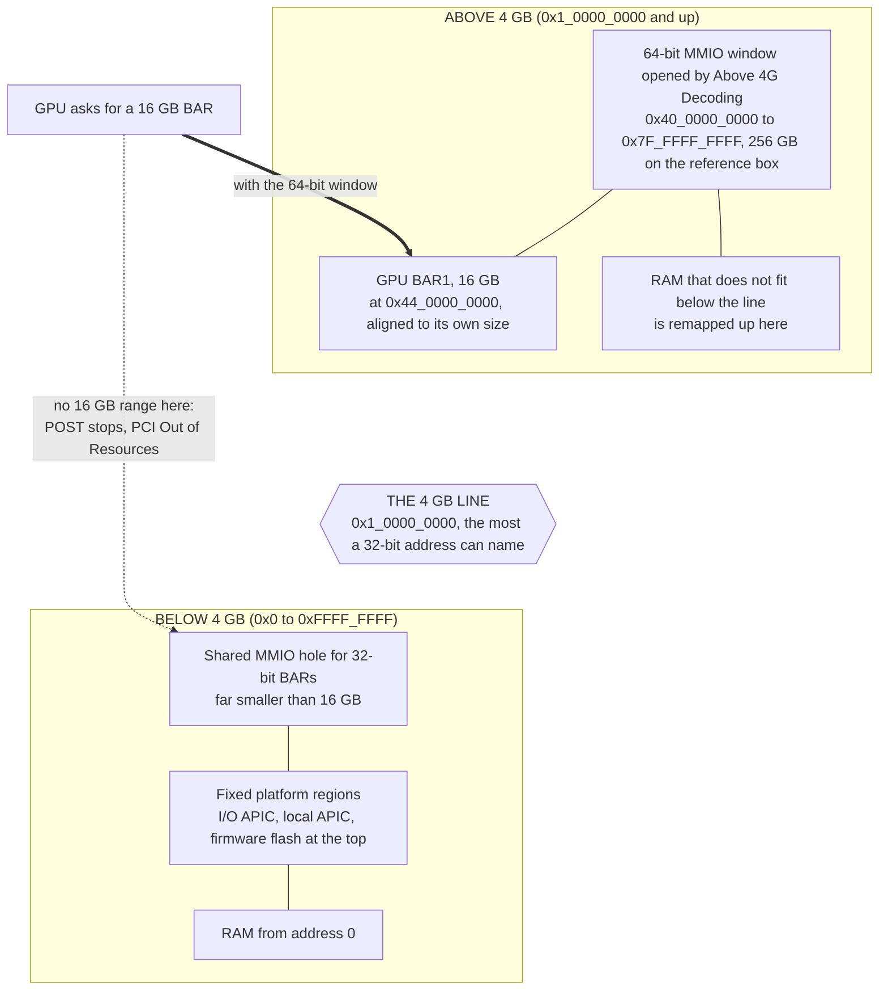
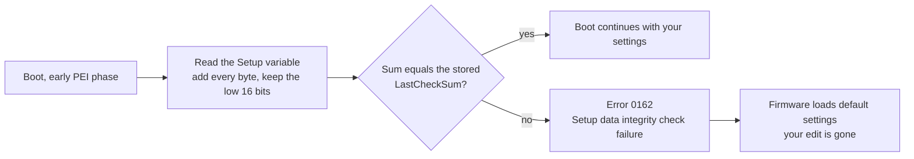

# How it works: address windows, setup variables, and the checksum guard

A 16 GB GPU asks the firmware for 16 GB of address space. A 32-bit address can name 4 GB in total, so a firmware that only hands out 32-bit windows cannot satisfy the request and POST stops. The setting that changes this, *Above 4G Decoding*, is a byte in the firmware's settings store. On the reference machine the vendor hides the menu entry but leaves the byte, and a second vendor feature (a checksum over that store) reloads defaults, according to the firmware analysis, if you edit the byte without updating it.

This page covers those layers in the order you meet them. The step-by-step is [04-procedure.md](04-procedure.md). What to do when something goes wrong is [05-safety-and-recovery.md](05-safety-and-recovery.md).

**Evidence labels.** *Verified on the reference build* means measured on the machine this project was developed on: a Lenovo ThinkCentre M720q Tiny, BIOS M1UKT72A, AMI-based firmware, with an NVIDIA A2 16 GB. On that machine an AI coding agent did the work: the image analysis ran on the agent's own computer, and the live variable reads and writes ran over SSH. The owner only installed and removed the card. *Reported* means a public post or a single observation this repo has not reproduced. *Unproven* means what it says.

**Offsets are per BIOS build.** Every offset below is a real value from the reference BIOS. None of them is a promise about your board, even one from the same vendor. The vendor's update package also lists sibling models (M720s/t, the M920 family, ThinkStation P330 Tiny), but nobody has reported whether their offsets match. [02-does-my-hardware-qualify.md](02-does-my-hardware-qualify.md) explains how to derive your own.

---

## 1. Address windows and the 4 GB line

### 1.1 What a BAR is

Every PCI Express function has a configuration header containing Base Address Registers (BARs). A BAR is how a device says "I need N bytes of address space" and how software answers "then you live at this address". After that, the CPU reaches the device with ordinary memory reads and writes to that range. This is memory-mapped I/O (MMIO).

Software finds N by writing all ones to the BAR and reading back which bits stuck. Sizes are powers of two and the base address must be aligned to the size ([PCI configuration space](https://en.wikipedia.org/wiki/PCI_configuration_space)). A memory BAR is either 32-bit (base below 4 GB) or 64-bit (base anywhere in a 64-bit space) ([PCI configuration space](https://en.wikipedia.org/wiki/PCI_configuration_space)). A 64-bit BAR occupies two consecutive BAR registers (PCI specification behaviour).

On the NVIDIA A2 the large one is BAR1, 16 GB, the size of the card's memory (verified on the reference build). That varies by card and by settings. A Tesla P100 is reported to expose 16 GB by default ([thread](https://winraid.level1techs.com/t/117195)). On an ASUS X299 board the author saw a card's BAR1 total go from 256 MiB to 16384 MiB after enabling Above 4G Decoding and Resizable BAR (single observation). This repo has no sourced BAR sizes for other datacenter models. Once a card runs, `nvidia-smi -q -d MEMORY` prints its BAR1 total.

### 1.2 Why a GPU asks the firmware

At power-on only the firmware is running. It walks the PCIe bus, reads each BAR's size, and hands out addresses from the windows the *root bridge* advertises. The root bridge is where PCIe meets the CPU's memory bus. EDK2, the open-source UEFI codebase most firmware derives from, describes four windows per root bridge: `Mem` and `PMem` below 4 GB, `MemAbove4G` and `PMemAbove4G` above it ([EDK2 `PciHostBridgeLib.h`](https://github.com/tianocore/edk2/blob/master/MdeModulePkg/Include/Library/PciHostBridgeLib.h)). The OS inherits the result. Linux can re-plan some of it later (for example with `pci=realloc`, see the [original kernel patch, 2011](https://lkml.iu.edu/hypermail/linux/kernel/1106.3/02173.html)), but only on a machine that got far enough to boot.

If the firmware cannot place a BAR it has no fallback at POST. That is the failure this repo is about.

### 1.3 The 4 GB ceiling and why 16 GB does not fit

32 address bits name 2^32 = 4,294,967,296 bytes. The card's BAR is 16 GiB, four times the whole 32-bit space, so it would not fit even if every byte below 4 GB were free.

They are not free. RAM starts at address 0. The top of the 32-bit space holds the MMIO hole shared by every device with a 32-bit BAR, plus fixed platform regions: the I/O APIC near `0xFEC00000`, the local APIC near `0xFEE00000`, and the firmware flash at the very top (standard x86 layout). Alignment makes it worse, since a 16 GiB BAR must start on a 16 GiB boundary.

A 64-bit BAR removes the size limit, but only if the root bridge has a window above 4 GB for it to land in.

### 1.4 What "Above 4G Decoding" and "Above 4GB MMIO" do

Both settings aim at one result: give the root bridge a 64-bit MMIO aperture and let the PCI enumerator place 64-bit BARs inside it. Menus name it differently. AMI menus usually say *Above 4G Decoding*. A second option, *Above 4GB MMIO BIOS assignment*, exists on some Intel-based boards. The reference board has both (section 2.5).

On the reference build, after the change, the Linux boot log showed a new root-bus window, read from ACPI `_CRS` without `pci=nocrs`:

```
pci_bus 0000:00: root bus resource [mem 0x4000000000-0x7fffffffff window]
```

| Quantity | Value |
|---|---|
| Window start | `0x40_0000_0000` (256 GiB) |
| Window size | 256 GiB |
| A2 BAR1 | 16 GiB at `0x44_0000_0000` (17 x 16 GiB, so aligned) |
| Other devices | on-board devices also received BARs above 4 GB and kept working |

The addresses and the device behaviour are verified on the reference build. The GiB figures are arithmetic on those addresses.



Two things these settings do not do. They do not resize anything: *Resizable BAR* is a separate feature that changes a BAR's size, and it needs 4G decoding on first ([ReBarUEFI README](https://github.com/xCuri0/ReBarUEFI)). And they are meant for UEFI-only boot, with the compatibility support module (CSM) off. The reference firmware's own help text says to disable CSM, and the ReBarUEFI wiki warns that enabling 4G decoding with CSM on can black-screen the machine or lock you out of setup ([ReBarUEFI wiki](https://github.com/xCuri0/ReBarUEFI/wiki/Enabling-hidden-4G-decoding)).

### 1.5 The symptom

The failure comes before any OS. On the reference machine, with the card installed and the window missing, the BIOS looped on `PCI OUT OF RESOURCES CONDITION: Insufficient PCI Resources Detected` until the card was removed (verified on the reference build).

Other boards fail differently. An HP EliteDesk 800 G5 SFF with a Tesla T4 is reported to black-screen with 3 long and 3 short beeps ([thread](https://winraid.level1techs.com/t/96245)). If the firmware gets past POST but leaves the card unassigned, the NVIDIA driver on Linux reports `BAR0 is 0M @ 0x0` and the probe fails ([NVIDIA forum](https://forums.developer.nvidia.com/t/tesla-t4-pci-i-o-region-invalid/120643), reported), and `lspci` shows the card without addresses or not at all.

A card whose BARs fit below 4 GB does not need any of this.

---

## 2. The mechanism: where the setting lives

### 2.1 UEFI variables are the settings store

UEFI firmware keeps persistent state in NVRAM as *variables*: a name, a vendor GUID, attribute flags, and a blob of bytes. Boot entries, Secure Boot keys and the BIOS setup configuration are all stored this way. OEM firmware typically keeps the whole BIOS menu in one large variable, each menu question at a fixed byte offset. On AMI-based firmware that variable is called `Setup`.

The three variables that matter on the reference board (verified on the reference build):

| Variable | GUID | Data size | Attributes | Holds |
|---|---|---|---|---|
| `Setup` | `EC87D643-EBA4-4BB5-A1E5-3F3E36B20DA9` | `0x1388` (5000) bytes | `0x7` | BIOS menu values |
| `PCI_COMMON` | `ACA9F304-21E2-4852-9875-7FF4881D67A5` | 7 bytes | `0x7` | AMI's PCI settings |
| `LastCheckSum` | `E102C8AA-0F10-4A0E-90A7-A6F816089BB7` | 2 bytes | `0x7` | Lenovo's integrity value for `Setup` |

Select by name, GUID and size together. Other variables share the `Setup` GUID under different names on the same board (`SetupCpuFeatures` is one). An early Dell XPS 8930 BIOS is reported to carry two variables both named `Setup` under different GUIDs, one a small dummy ([grub-mod-setup_var README](https://github.com/datasone/grub-mod-setup_var)).

The attribute word is a bit field ([Microsoft docs](https://learn.microsoft.com/en-us/windows/win32/api/winbase/nf-winbase-setfirmwareenvironmentvariableexa)):

| Bit | Name | Meaning |
|---|---|---|
| `0x01` | NON_VOLATILE | survives power-off |
| `0x02` | BOOTSERVICE_ACCESS | readable and writable before the OS takes over |
| `0x04` | RUNTIME_ACCESS | still reachable from the running OS |
| `0x08` | HARDWARE_ERROR_RECORD | error records |
| `0x10` | AUTHENTICATED_WRITE_ACCESS | writes need a signature |
| `0x20` | TIME_BASED_AUTHENTICATED_WRITE_ACCESS | writes need a signed, timestamped payload |
| `0x40` | APPEND_WRITE | append instead of replace |

`0x7` means non-volatile, boot-time and runtime: stored across power cycles and reachable from Linux.

On at least some boards these variables sit in the firmware's NVRAM area on the SPI flash chip, not in battery-backed CMOS RAM. Whether a CMOS clear resets them varies by board. A Dell Precision T3620 report says a CMOS battery pull cured a dead boot after an edit while the edit itself persisted ([discussion](https://github.com/xCuri0/ReBarUEFI/discussions/211)). A Dell laptop report says CMOS jumpers do not reset NVRAM settings ([thread](https://winraid.level1techs.com/t/103135)). Do not assume a CMOS clear is your way out. See doc 05.

### 2.2 A hidden menu option is still a variable

The BIOS menu is generated from a description compiled into the firmware: HII forms in a bytecode called IFR (Internal Forms Representation). Each question records its prompt, which store it reads (`VarStoreId`), where (`VarOffset`), its options and defaults, and conditions (`SuppressIf`, `GrayOutIf`) that decide whether it is drawn. A vendor hides an option by leaving it off every page it shows, or by suppressing it. The variable bytes and the code that reads them stay.

For the reference board, the vendor image contains this question. Abridged from [IFRExtractor-RS](https://github.com/LongSoft/IFRExtractor-RS) output, condensed by hand:

```
OneOf  Prompt: "Above 4GB MMIO BIOS assignment"
       QuestionId: 0x54   VarStoreId: 0x1   VarOffset: 0xA49
       Option: Enabled  = 1
       Option: Disabled = 0     (Default, MfgDefault)
  ... enclosed in: SuppressIf EqIdVal QuestionId 0x2746 == 0xF
```

`VarStoreId: 0x1` is the `Setup` store, `0x1388` bytes. The question is in the image, but no page the vendor shows includes it. The `SuppressIf` is a separate AMI rule that hides the option when *Aperture Size* is set to 2048 MB. All of this was read from the vendor's M1UKT77A image. The machine itself ran 72A, and 6 of 6 offsets checked against the live variable matched (verified on the reference build).

Getting the offset right is the part people get wrong:

- Read offsets per question, never by grep. In the reference dump, grepping for the phrase "Above 4GB MMIO" first hits the last line of the *Help text* of the preceding question, *Aperture Size*, and that line carries Aperture Size's own offset. An early attempt took it for the gate and concluded the option was already enabled. In fact the byte at that offset is Aperture Size, and its value 1 means "256 MB", the factory default.
- Grepping for the offset number also fails: `0xA49` appears as an unrelated `QuestionId` for *Intel Speed Shift Technology*.
- Match the write width to the question. This question is one byte. Writing wider overwrites the neighbours.

The tools to do this properly are UEFITool / UEFIExtract to unpack a vendor image ([UEFITool](https://github.com/LongSoft/UEFITool)) and IFRExtractor-RS to turn a form module into text ([IFRExtractor-RS](https://github.com/LongSoft/IFRExtractor-RS)). The [ReBarUEFI wiki](https://github.com/xCuri0/ReBarUEFI/wiki/Enabling-hidden-4G-decoding) walks through the same method. Reading IFR tells you what the *menu* does. It does not prove the firmware *code* consumes the value, a caution Kostr's hidden-settings lesson makes explicitly ([Kostr's lesson](https://github.com/Kostr/UEFI-Lessons/tree/master/Lessons_uncategorized/Lesson_Hidden_BIOS_settings)). The proof is the physical outcome (section 4).

**Dynamic questions.** *Above 4G Decoding* in `PCI_COMMON` has no static IFR entry on this board. AMI's PciBus driver appears to inject it at runtime (inference), so the static dump shows only its neighbours (*BME DMA Mitigation* at byte 5, *Hot-Plug Support* at byte 2). Byte 3 was located by cross-reference rather than read from a form:

- The same GUID on other boards puts the switch at byte 3 (Dell Precision T3620, [discussion](https://github.com/xCuri0/ReBarUEFI/discussions/211); Lenovo ThinkStation P310, [thread](https://winraid.level1techs.com/t/94916); both reported).
- PciBus's built-in defaults, used when `PCI_COMMON` is missing, set byte 3 to 1.
- Lenovo's own SMM code toggles byte 3.

The last two come from the author's disassembly and were not re-run for this page. A live dump of the HII database from a UEFI shell would settle it directly ([Kostr's lesson](https://github.com/Kostr/UEFI-Lessons/tree/master/Lessons_uncategorized/Lesson_Hidden_BIOS_settings)).

### 2.3 efivarfs and the 4-byte attribute prefix

Linux exposes each variable as a file named `<Name>-<guid in lowercase>` under `/sys/firmware/efi/efivars/`. The first 4 bytes of the file are the attribute word, little-endian. The rest is the data ([efivarfs docs](https://docs.kernel.org/filesystems/efivarfs.html)). So a file is always 4 bytes longer than the variable. On the reference board `ls -l` shows 5004, 11 and 6 bytes for the three variables above (verified on the reference build).

Read-only commands, safe to run:

```sh
ls -l /sys/firmware/efi/efivars | grep -i -E 'setup|pci_common|checksum'
sudo xxd /sys/firmware/efi/efivars/PCI_COMMON-aca9f304-21e2-4852-9875-7ff4881d67a5
```

The reference `PCI_COMMON` file, as 4 prefix bytes plus 7 data bytes (verified on the reference build):

| State | Prefix | Data (bytes 0 to 6) |
|---|---|---|
| Factory | `07 00 00 00` | `00 00 01 00 00 00 00` |
| After unlock | `07 00 00 00` | `01 00 01 01 00 00 00` |

Byte 3 is the *Above 4G Decoding* byte. Byte 0 reads 1 in the second row because of a wrong first attempt; see section 2.5.

Non-standard variables appear as immutable files, because removing them has made some firmware fail to POST. `chattr -i` lifts the flag. The kernel documentation says this does not prevent removal, only accidents ([efivarfs docs](https://docs.kernel.org/filesystems/efivarfs.html)). Writes, and the handling of the attribute prefix and write size, are in doc 04.

### 2.4 Why some boards expose the variable and some do not

Firmware policy decides whether the OS can write `Setup` at all, and it differs between boards. What you see decides your route:

| What you see | Meaning | Route |
|---|---|---|
| Variable listed in efivarfs, attributes `0x7` | Reachable at runtime | Linux efivarfs (reference build) |
| Variable absent from efivarfs, or attributes lack `0x4` | Boot-time only; the OS cannot see it | One-shot UEFI shell tool such as [setup_var.efi](https://github.com/datasone/setup_var.efi) |
| Attributes contain `0x10` or `0x20` | Authenticated variable | Stop. These tools do not sign writes |
| Listed, but writes fail | Locked by firmware | Stop |

For the second row, the author met it once on an ASUS ROG Strix X299-E Gaming II (BIOS 2103): `Setup` and `PCI_COMMON` returned Windows error 203 from the firmware-variable API, and the bytes had to be written from a UEFI shell (single observation, unconfirmed elsewhere).

For the last row, EDK2 gives platforms several ways to lock a variable after firmware initialisation: `VariablePolicy` ([header](https://github.com/tianocore/edk2/blob/master/MdeModulePkg/Include/Protocol/VariablePolicy.h)), `VarCheck` ([header](https://github.com/tianocore/edk2/blob/master/MdeModulePkg/Include/Library/VarCheckLib.h)) and the older `VariableLock` ([header](https://github.com/tianocore/edk2/blob/master/MdeModulePkg/Include/Protocol/VariableLock.h)). Reports of refusals include an HP EliteDesk 800 G5 whose `setup_var.efi` write returned ACCESS_DENIED ([thread](https://winraid.level1techs.com/t/96245)) and ASUS boards with a "UEFI Variables Runtime protection" option ([thread](https://winraid.level1techs.com/t/103324)). On Linux a locked write comes back as an error such as `EROFS`, `EACCES` or `EINVAL`. Treat any non-zero write result as a stop, restore from your backup, and do not retry with different attributes.

There is also a matter of vendor age. CERT/CC documented in 2014 that on some systems the `Setup` variable could be overwritten through OS APIs, with AMI, Dell, Insyde, Intel and Lenovo listed as affected ([CERT/CC VU#758382](https://kb.cert.org/vuls/id/758382)). Newer firmware may refuse writes that older builds accepted.

### 2.5 The two gates, and what is not proven

| Gate | Store | Offset | Question | Factory | Unlocked |
|---|---|---|---|---|---|
| 1 | `Setup` | `0xA49` | *Above 4GB MMIO BIOS assignment* (QuestionId `0x54`) | 0 (Disabled) | 1 |
| 2 | `PCI_COMMON` | 3 | *Above 4G Decoding* (dynamic question) | 0 | 1 |

The factory and unlocked values were read from the live variables (verified on the reference build). That byte 3 of `PCI_COMMON` is the *Above 4G Decoding* byte comes from cross-reference with other boards (reported, see section 2.2), not from a form. The offsets are for its BIOS only.

Be exact about what that establishes:

- **Together, it worked.** The second attempt wrote `Setup[0xA49]`, the matching `LastCheckSum` and `PCI_COMMON[3]` in one run. The box then booted without the card, the 256 GB root window appeared, and after the card was installed it passed POST and the driver bound.
- **Which gate mattered is unproven.** That run changed `Setup[0xA49]` and `PCI_COMMON[3]` together, so their effects were never separated.
- **The evidence leans to the `Setup` gate.** The new 64-bit root window appeared before any card was installed. The author's earlier disassembly of PciBus found it reads only bytes 0 and 5 of `PCI_COMMON` in this build (not re-run for this page). The ReBarUEFI wiki says the `PCI_COMMON` store usually does not enable 4G decoding even though it holds the setting, and adds that some platforms also need the separate MMIO assignment option ([ReBarUEFI wiki](https://github.com/xCuri0/ReBarUEFI/wiki/Enabling-hidden-4G-decoding)). On other boards byte 3 mattered or was already set (Dell Precision T3620, ASUS X299 above).
- **The test that would settle it** is cheap: restore only byte 3, reboot without the card, read `/proc/iomem`. It has not been done.
- **Do not write `PCI_COMMON` byte 0.** The first attempt wrote it on the guess that AMI's first field is the switch. That was wrong, nothing changed, and byte 0 stayed at 1 afterwards. What it controls is unknown; the author's disassembly suggests PciBus registers an extra callback when it is 1. A recipe has no reason to touch it.

---

## 3. The vendor integrity guard

### 3.1 The concept

Some vendors protect the settings store with a checksum kept in a second variable. Early in boot, a firmware module re-computes a sum over the store and compares it with the stored value. A mismatch means "the settings are corrupt", and the firmware reloads defaults. Your edit is gone along with every other custom setting, and the board reports an error on that boot.

The reference board does exactly this. The guard is Lenovo-specific: an ASUS X299 board the author tested had none, and bytes written from a UEFI shell survived a full power cycle (single observation). For Dell and HP, no public documentation of a Setup checksum was found, so whether they keep one is unknown. The failure message is Lenovo POST error 0162, "Setup data integrity check failure". Lenovo's published text for the code, on a ThinkSystem server page with the same code and wording, says the checksum of the BIOS setup data in NVRAM is bad and that *Save Changes and Exit* clears the entry ([Lenovo POST error 0162](https://pubs.lenovo.com/st50/POST_ERROR_0162)). That page documents the message, not the ThinkCentre mechanism.



### 3.2 What the reference guard does

The PEI half of the guard is a module named `SetupCheckSumPei`, GUID `76D1059D-2E22-40EF-A31F-C49DBBC0DBCE`. PEI ("pre-EFI initialization") is the earliest firmware phase, before the main driver phase (DXE). The module was found by searching the raw vendor image for the UTF-16 string `LastCheckSum` and mapping the hit to the UEFIExtract report. PEI volumes are stored uncompressed, which is why the strings are visible. DXE is compressed, so the text "Error 0162" cannot be found the same way.

Its x86 bytes were decoded by hand from Lenovo's public BIOS update for the M720q family (version M1UKT77A; this repo does not redistribute it). Structure is high confidence, instruction-level detail moderate. The module:

1. Reads `Setup` with its GUID.
2. Adds every byte of the data into a 16-bit accumulator. No carry fold, no complement.
3. Reads `LastCheckSum` (2 bytes, little-endian, GUID `E102C8AA-0F10-4A0E-90A7-A6F816089BB7`, **not** the `Setup` GUID).
4. Compares for exact equality.
5. On a mismatch, signals a Lenovo PPI. The DXE side is then expected to raise error 0162 and run `SetupLoadDefaultDxe` (from earlier image analysis, not re-run).

The PEI half is decoded from bytes. The DXE half rests on module names found in the image and on the error text above. The 0162 screen was not provoked on the reference build, because the checksum was updated together with the write.

Two further observations from the same bytes:

- **Skip condition.** The check is skipped for boot mode `0x20`, which the UEFI PI specification assigns to recovery mode (constant not re-checked against the spec text for this page). The bytes show no comparison against the S3-resume mode value. Whether the check runs on S3 resume is unverified, so do not rely on any skip.
- **Missing variable.** If `LastCheckSum` cannot be read, the decoded code returns without raising the error. That describes the code. It is not a method: nothing is known about whether later boot stages recreate the variable, and deleting non-standard variables has bricked firmware ([efivarfs docs](https://docs.kernel.org/filesystems/efivarfs.html)). A safe tool never deletes it.

### 3.3 The relationship is measured, not constant

You would expect the stored value to equal the sum you compute from Linux. It does not have to. On the reference box, with clean boots and no error at any point:

| Date | `LastCheckSum` | Sum of `Setup` as seen from Linux | Stored minus sum |
|---|---|---|---|
| 2026-09-04, before the write | `0xDC24` | `0xDC23` | +1 |
| 2026-09-04, after the write | `0xDC25` | `0xDC24` | +1 |
| 2026-10-07 | `0xDC25` | `0xDC25` | 0 |

Verified on the reference build. The Linux-visible sum rose by 1 between the last two rows while the stored value stayed put, and the board still booted without error. If the PEI compare ran as decoded, PEI's own view of `Setup` summed to the stored value each time, so the PEI and Linux views differ, and not by a fixed amount (inference). Why is unknown. Two candidates, both unverified: a byte in `Setup` that firmware rewrites late in boot, or a rewrite triggered by hardware changes made to the box between the dates.

Consequences:

- A tool that assumes `stored == sum` would have refused to run on the first date.
- A tool that assumes `stored == sum + 1` would have written the wrong value on the later one.
- Measure the difference live, immediately before writing, and carry it through.

A read-only measurement. It was tested here on synthetic files that reproduce the first row; on a real machine run it as root against the real directory:

```python
E = "/sys/firmware/efi/efivars/"

def rd(name):
    raw = open(E + name, "rb").read()
    return int.from_bytes(raw[:4], "little"), raw[4:]   # (attributes, data)

sa, setup = rd("Setup-ec87d643-eba4-4bb5-a1e5-3f3e36b20da9")
la, lcs   = rd("LastCheckSum-e102c8aa-0f10-4a0e-90a7-a6f816089bb7")

cur    = sum(setup) & 0xFFFF                 # 16-bit byte sum, no carry fold, no complement
stored = int.from_bytes(lcs, "little")       # stored little-endian
delta  = (stored - cur) & 0xFFFF             # a negative difference wraps to a large number

print(f"attrs: Setup={sa:#x} LastCheckSum={la:#x}   Setup length={len(setup):#x}")
print(f"sum16(Setup)={cur:#06x}  LastCheckSum={stored:#06x}  delta={delta}")
```

The new stored value is `sum16(new Setup) + delta`. Worked through with the first date's numbers: flipping `Setup[0xA49]` from 0 to 1 adds 1 to the sum, so the sum goes from `0xDC23` to `0xDC24`, and the new `LastCheckSum` is `0xDC24 + 1 = 0xDC25`. That is the value that was written.

### 3.4 What a safe tool does about it

- **Bound the delta.** The original one-off script on the reference build refused to continue unless the delta was 0 to 2 (a heuristic, not derived from anything). This repo's tools allow 0 or 1 by default (profile key `checksum.max_delta`). Anything larger means the model of the guard is wrong for this board. Do not guess.
- **Order the writes.** Three variable writes are not atomic. Write `Setup` and `LastCheckSum` back to back, then `PCI_COMMON`, so the window in which `Setup` has changed but its checksum is stale is as short as possible. If the process dies inside that window, the next boot raises error 0162 and loads defaults.
- **Treat the flags as the real gate.** After the reboot, check that `SetupDataChecksumError`, `RestoreSetupDataFlag` and `BIOSSetupDataChangedFlag` are all 0 and that `SysEventLogCount` has not grown. Those were the post-boot checks on the reference build.
- **Detect guards before writing.** On an unknown board, look four ways. Scan the firmware image for modules or strings containing `CheckSum`, `Crc`, `Hash`, `Integrity` or `SetupData`; this is how the reference guard was found. List the live variables for names such as `*Sum*`, `*Crc*`, `*Hash*`, `*Error*` and `RestoreSetup*`. Change one visible option through the normal menu, save, and diff every variable before and after. Then test candidate algorithms (16-bit sum, 8-bit sum, CRC16, CRC32) against the `Setup` blob. The last three checks are proposed and have not been run on another board.
- **Refuse what you cannot model.** An unknown algorithm, an authenticated variable, or a value only SMM code can write means stop. A P330 tower user reports that a tool accepted the enable flag and the board "disables it at restart" ([thread](https://winraid.level1techs.com/t/104196)). That behaviour fits a checksum guard reloading defaults, but the cause is unconfirmed.

---

## 4. Verify the outcome, not the echo

Reading the byte back proves the firmware accepted the write. It does not prove the firmware uses it. A P310 owner reports the variable reading 1 while GPU-Z still says 4G decoding is off ([thread](https://winraid.level1techs.com/t/94916)). The test that mattered on the reference build was physical, in two stages:

1. **Reboot without the card.** The 64-bit root window appeared, and the flags above stayed 0.
2. **Install the card.** `lspci` showed the A2 with Region 1 at 16 GB inside the new window, and `nvidia-open` bound.

The commands for both stages are standard Linux tools: `dmesg | grep -i 'root bus resource'`, `cat /proc/iomem` (look for the window and for BARs above `0x100000000`), and `lspci -vv -s <bus:dev.fn>` (look for `64-bit, prefetchable` regions with addresses above 4 GB).

The first reboot goes without the card so that a bad write costs a reboot and a restore from backup, not a boot loop with the card in. A Dell Precision T3620 report describes a board that dropped into BIOS on every boot while the GPU was installed and was fine with it removed ([discussion](https://github.com/xCuri0/ReBarUEFI/discussions/211)). Doc 04 keeps that order.

Where each claim stands (verified, reported, unproven) is stated where it appears, mainly in sections 2.5, 3.2 and 3.3. Sources are linked inline; prior tools and threads are listed in [09-tooling-and-prior-art.md](09-tooling-and-prior-art.md).

---

Next: [04-procedure.md](04-procedure.md).
